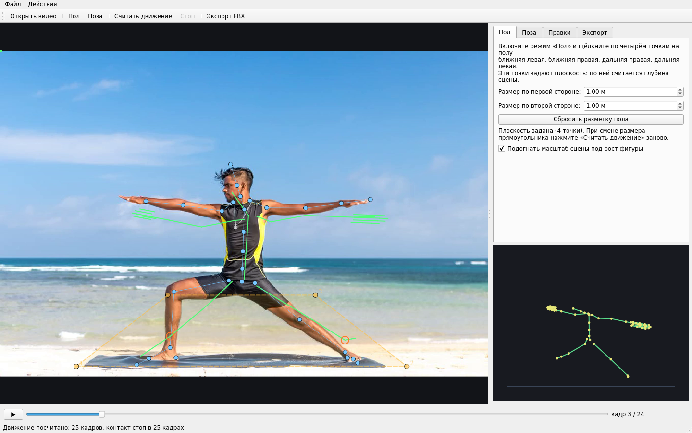
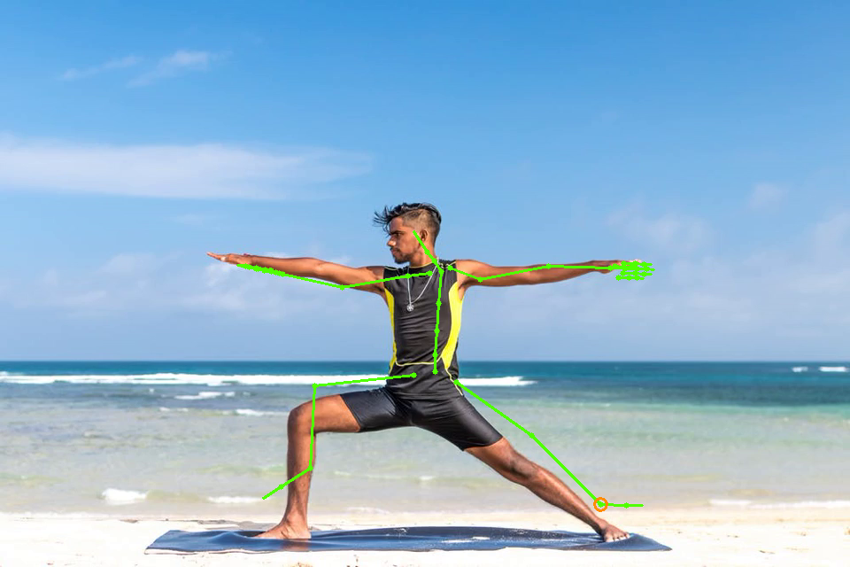

# MoCap Studio

Захват движения по видео: программа распознаёт позу человека в ролике, переносит
её на настраиваемый скелет (в том числе с пальцами), прижимает стопы к полу и
отдаёт результат в FBX (Unreal Engine, 3ds Max, Maya, Blender) или BVH.

Работает на Windows и Linux, на чистом CPU, без интернета во время работы.



Наложение рассчитанного скелета на исходный кадр:



---

## Что умеет

| Возможность | Как это выглядит для пользователя |
|---|---|
| Загрузка видео | Кнопка «Открыть видео» — ролик любого разрешения, mp4/mov/mkv |
| Разметка пола | Режим «Пол»: четыре клика по точкам на полу задают плоскость сцены |
| Поза первого кадра | Режим «Поза»: узлы скелета тянутся мышью, длины костей подстраиваются |
| Расчёт движения | Кнопка «Считать движение» — детекция позы и кистей, затем решение скелета |
| Стопы на полу | Стоящая нога «прибивается» к плоскости: стопа не скользит, IK держит позу |
| Ручные правки | Вкладка «Правки»: поворот любой кости на диапазоне кадров, движение пересчитывается |
| Экспорт | FBX (ASCII 7.4) с пресетами имён Unreal / Mixamo / 3ds Max Biped, плюс BVH и JSON-отчёт |
| Своя 3D-модель | Вкладка «Модель»: загрузите свой персонаж со скелетом (.glb/.gltf/.fbx) — кости сопоставляются автоматически, анимация сразу видна на вашей модели |
| 3D-предпросмотр | Правая нижняя панель: вид на скелет и на загруженную модель, вращается мышью |

---

## Установка (Windows 11)

**Вариант 1 — готовый .exe.** Сборка идёт в GitHub Actions: залейте проект в
репозиторий и запустите workflow «Build Windows exe» — в артефактах появится
`MoCapStudio-windows.zip` с готовым `MoCapStudio.exe`. На целевой машине нужен
только [Visual C++ Redistributable](https://aka.ms/vs/17/release/vc_redist.x64.exe).

**Вариант 2 — собрать у себя.** Нужен Python 3.11 с
[python.org](https://www.python.org/downloads/) (отметьте **Add Python to PATH**):

```
install.bat     -> окружение .venv, зависимости, модели распознавания (~38 МБ)
run.bat         -> запуск из исходников
build_exe.bat   -> dist\MoCapStudio.exe (standalone, ~230 МБ)
```

Модели MediaPipe (~38 МБ) вшиты в `.exe` — интернет при работе не нужен.

### Linux / macOS

```bash
python3 -m venv .venv
.venv/bin/pip install -r requirements.txt
.venv/bin/python tools/download_models.py
.venv/bin/python run_gui.py
```

На Linux MediaPipe требует системные библиотеки:

```bash
sudo apt install libegl1 libgles2
```

---

## Как запустить (коротко)

1. Получите `.exe` (сборка в CI) **или** распакуйте исходники и выполните
   `install.bat` → `run.bat`.
2. В программе: **Открыть видео** → режим **«Пол»** (4 клика по полу) →
   вкладка **«Поза»** → «Взять позу из детекции» → «Применить позу» →
   **«Считать движение»** → таймлайн → вкладка **«Модель»** (загрузить свою
   3D-модель) → вкладка **«Экспорт»** → **FBX**.

Если что-то пошло не так:

| Симптом | Что делать |
|---|---|
| «Не удалось скачать модели» | нужен интернет; программа скачает модели сама при первом запуске |
| Модель не привязалась | вкладка «Модель» → выберите пресет имён костей или привяжите кости вручную в таблице |
| Скелет не попадает в человека | разметьте пол прямо под ногами и укажите реальный размер прямоугольника; снимите галочку автоподгонки масштаба, если размер известен точно |
| `.exe` не запускается | поставьте Visual C++ Redistributable x64 (https://aka.ms/vs/17/release/vc_redist.x64.exe) |
| Ошибка при запуске | рядом с `.exe` появится `mocap_studio_error.log` с подробностями |

## Порядок работы

1. **Открыть видео.** Показывается первый кадр.
2. **Разметить пол** (вкладка «Пол» → режим «Пол»): щёлкните четыре точки на полу
   в порядке *ближняя левая → ближняя правая → дальняя правая → дальняя левая* и
   укажите реальный размер прямоугольника в метрах. Эта плоскость даёт сцене
   глубину: без неё по одной камере расстояние определить нельзя.
   Если размер прямоугольника известен точно, галочку «Подогнать масштаб сцены
   под рост фигуры» можно снять.
3. **Задать позу** (вкладка «Поза»): «Взять позу из детекции» подставляет узлы
   по найденной позе, дальше узлы можно перетащить так, чтобы скелет совпал с
   человеком, и нажать «Применить позу» — длины костей рига станут как у актёра.
4. **Считать движение.** Детекция идёт в отдельном потоке, прогресс виден в
   строке состояния; готовое движение листается таймлайном.
5. **Поправить** (вкладка «Правки»): выберите кость, кадры, ось и угол →
   «Добавить правку и пересчитать». Движение считается заново целиком, поэтому
   стопы, прижатые к полу, остаются на месте, а потомки кости едут за родителем.
6. **Своя модель** (вкладка «Модель»): «Загрузить модель…» → выберите свой
   персонаж со скелетом. Программа сопоставит его кости с костями рига
   (сначала по именам — UE/Mixamo/Biped, затем по позе) и сразу покажет
   анимацию на вашей модели. Непривязанные кости можно поправить вручную
   в таблице справа.
7. **Экспорт** (вкладка «Экспорт»): FBX / BVH / отчёт JSON.

### Своя 3D-модель

Поддерживаются форматы со скелетом и весами скиннинга:

* **.glb / .gltf** (glTF 2.0) — рекомендуется: экспорт из Blender, Unreal,
  3ds Max одной кнопкой;
* **.fbx** — бинарный и ASCII.

Как это устроено:

1. Из файла читаются вершины, веса скиннинга, inverse bind matrices и
   иерархия костей модели.
2. Кости модели сопоставляются с костями рига: сначала по именам (три
   пресета: Unreal, Mixamo, 3ds Max Biped — выигрывает тот, где совпадений
   больше), оставшиеся — по положению в bind-позе. Таблица справа позволяет
   поправить привязку вручную.
3. Для каждого кадра считается новая мировая матрица каждой кости модели:

   `M_j = R_j(риг) · (M_j(bind) · R_j(bind)⁻¹)`

   то есть bind-поза модели приводится к текущей позе рига.
4. Вершины пересчитываются обычным линейным скиннингом с весами модели.

Проверено автоматическим тестом (`tests/test_model_pipeline.py`): в покое
модель воспроизводит bind-позу с точностью 0.8 см, при повороте кости
двигаются только «её» вершины.

### Как это работает внутри

* **Детектор** — MediaPipe Pose (heavy) + Hand Landmarker: 33 точки тела и по 21
  на каждую кисть.
* **Риг задаёт длины, детектор — только направления.** Метрика нейросети не
  влияет на размер персонажа: длины костей берутся из рига (или из позы первого
  кадра), а из детектора берутся только направления осей и положение стоп.
* **Глубина** — из плоскости пола: луч камеры пересекается с плоскостью и даёт
  мировую точку под стопой.
* **Контакт стопы** определяется по углу в колене (шкала не зависит от масштаба
  нейросети): прямая нога — стопа на полу, изогнутая — стопа в воздухе.
* **Twist (скручивание кости)** задаётся полюсами: для рук — «вперёд от тела»,
  для пальцев — соседний палец, для ног — вверх.
* **Правки** хранятся не как «готовая» анимация, а как ограничения
  (мировое вращение кости на отрезке кадров с зоной сглаживания) — поэтому
  после правки движение пересчитывается и остаётся согласованным.

---

## Экспорт

FBX пишется собственным кодом (без Autodesk SDK — его нет в свободном доступе):

* формат FBX ASCII 7.4, единицы — сантиметры, вращение — эйлеры XYZ в градусах;
* иерархия `LimbNode`, анимационный стек и кривые T/R/S на каждый кадр;
* пресеты имён костей: **Unreal Engine** (`root`, `pelvis`, `spine_01…`,
  `clavicle_l`, `upperarm_l`, `lowerarm_l`, `hand_l`, `thumb_01_l` …),
  **Mixamo** (`mixamorig:Hips`, `mixamorig:Spine`, `mixamorig:LeftArm` …),
  **3ds Max Biped** (`Bip01 Pelvis`, `Bip01 L UpperArm` …).

Если нужен бинарный FBX — экспортируйте BVH/FBX через Blender:
`import → FBX 7.4 Binary`.

Формат проверен автоматическим тестом round-trip: файл разбирается тем же
способом, что и импортёром, из него восстанавливаются локальные повороты и
пересчитывается FK — расхождение с исходным решением 0.00 см (`tests/test_fbx_roundtrip.py`).
Импорт в сам 3ds Max/Unreal в среде разработки не проверялся (нет доступа к
лицензионным приложениям), поэтому при первом импорте стоит сверить позу.

---

## Командная строка

Для пакетной обработки есть CLI (тот же движок, без графики):

```bash
python -m mocap_studio.cli \
    --video walk.mp4 \
    --plane 150,620 800,620 620,480 330,480 \
    --plane-size 3.0 2.0 \
    --out walk.fbx --bvh walk.bvh --report walk.json
```

Полезные ключи: `--start/--end` (диапазон кадров), `--no-auto-scale`
(не подгонять масштаб сцены), `--preset mixamo`, `--fps 60`, `--preview out.mp4`
(ролик со скелетом поверх видео), `--user-pose pose.json` (длины костей из
позы первого кадра), `--corrections corr.json` (ручные правки).

---

## Структура проекта

```
mocap_studio/
  core/
    rig.py        риг: 53 кости (включая 15 фаланг на руку), FK, пресеты имён
    plane.py      плоскость пола: гомография, камера, переходы камера<->мир
    detect.py     обёртка над MediaPipe Pose + Hands
    solve.py      решатель: контакт стоп, IK ног, локальные кватернионы
    corrections.py слой ручных правок
    export/       экспорт FBX (ASCII) и BVH
    preview.py    проекция скелета обратно в кадр
    math3d.py     векторы, кватернионы, эйлеры
  gui/
    app.py        главное окно, панели, таймлайн
    view.py       холст видео (разметка, поза, оверлей) и 3D-взгляд
    worker.py     детекция в фоновом потоке
    mesh.py       загрузка моделей: glTF/GLB и FBX (свой парсер, без SDK)
    skin.py       сопоставление костей и скининг модели под риг
  gui/
    app.py        главное окно, панели, таймлайн
    view.py       холст видео (разметка, поза, оверлей)
    glview.py     3D-вьюпорт: скелет рига и скелетная модель (software-рендер)
    worker.py     детекция в фоновом потоке
tests/
  test_solver_synthetic.py  синтетический тест решателя (погрешность углов, стопы)
  test_fbx_roundtrip.py     чтение собственного FBX обратно и сверка с решением
  test_model_pipeline.py    загрузка GLB/FBX, привязка костей, скининг
  test_gui_smoke.py          дымовой тест GUI, модели и экспорта
```

## Тесты

```bash
.venv/bin/python tests/test_solver_synthetic.py
.venv/bin/python tests/test_fbx_roundtrip.py
.venv/bin/python tests/test_model_pipeline.py
.venv/bin/python tests/test_gui_smoke.py
```

Синтетический тест строит эталонную анимацию, прогоняет её через решатель и
проверяет, что средняя ошибка угла костей меньше 6°, щиколотка стоит на полу на
высоте 9 см, а контакт стоп определяется во всех кадрах.

## Ограничения

* Распознавание — 2D-видео: сцена, снятая в одном ракурсе; персонаж не должен
  выходить за пределы отмеченного участка пола.
* Камера считается вертикальной пинхоль-моделью (FOV 50°); сильный «рыбий глаз»
  или широкий объектив дадут погрешность в масштабе.
* Кисти распознаются только когда ладонь достаточно крупная в кадре; у мелких
  рук пальцы остаются прямыми (направление из позы).
* Точность длин костей — на уровне «режиссёрская» (единицы процентов), а не
  фото-метрология: длины берутся из 2D-позы первого кадра.
* 3D-рендер программный (без GPU): на модели в 20–50 тыс. треугольников
  даёт 10–20 кадров в секунду — достаточно для предпросмотра.
